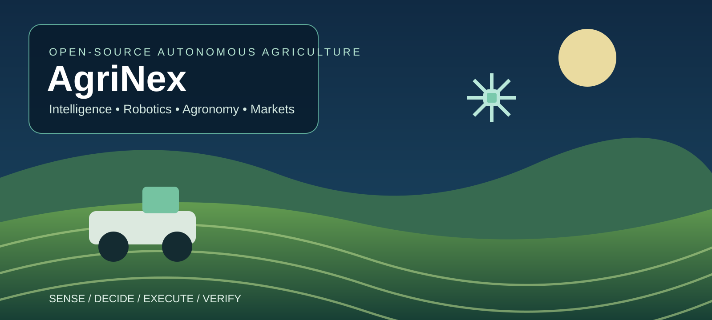
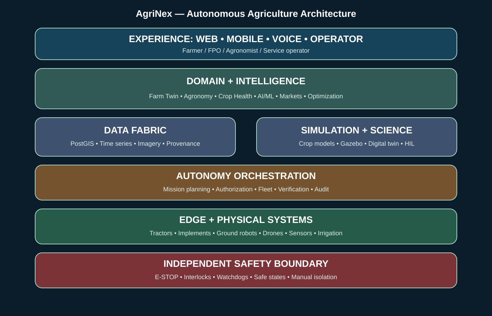

# AgriNex
## Open-source Autonomous Agriculture Intelligence & Robotics Platform

**Mission:** make precision and autonomous agriculture accessible through interoperable AI, agronomy, robotics, sensing, simulation and open engineering.

AgriNex is a modular research and engineering programme for the complete agricultural lifecycle: land intelligence and preparation, seeding, irrigation, nutrition, crop protection, continuous plant-health monitoring, harvesting, post-harvest operations and market intelligence.

> **North star:** a farm that can sense, reason, plan, act and verify with minimal routine human intervention—while people retain control of safety-critical, regulated and high-impact decisions.

### Current engineering status
V0.1 is merged to `main`; API CI passed on 2026-11-25. The API remains a local demonstrator. Production identity/tenant isolation, PostGIS migrations and ROS simulation validation are pending. Start with the [next-activities and research plan](docs/engineering/MASTER_PLAN_AND_RESEARCH.md).

### Start here
- [Complete project blueprint](docs/COMPLETE_BLUEPRINT.md)
- [Research and competitor catalogue](docs/RESEARCH_CATALOG.md)
- [System architecture](docs/ARCHITECTURE.md)
- [Robotics and hardware plan](docs/ROBOTICS_HARDWARE.md)
- [Agronomy and AI plan](docs/AGRONOMY_AI.md)
- [Market intelligence](docs/MARKET_INTELLIGENCE.md)
- [Standards and safety](docs/STANDARDS_SAFETY.md)
- [Roadmap](docs/ROADMAP.md)
- [Repository structure](docs/REPOSITORY_STRUCTURE.md)

### 15 engineering domains
AGX-01 Farm Digital Twin; AGX-02 Agricultural Data Intelligence; AGX-03 AI Agronomist; AGX-04 Soil Intelligence; AGX-05 Land Preparation; AGX-06 Seeding and Planting; AGX-07 Irrigation; AGX-08 Nutrition/Fertigation; AGX-09 Crop Protection; AGX-10 Aerial Robotics; AGX-11 Ground Robotics; AGX-12 Crop Health Intelligence; AGX-13 Harvest/Post-Harvest; AGX-14 Market Intelligence; AGX-15 Farm Autonomy Orchestrator.

### Initial technology direction
React/TypeScript; Python/FastAPI; PostgreSQL/PostGIS; GDAL/Rasterio/QGIS; PyTorch/OpenCV/ONNX; ROS 2/Nav2/Gazebo; MQTT; TimescaleDB; S3-compatible object storage; OR-Tools; OpenTelemetry/Prometheus/Grafana; embedded C/C++/Rust. Pin supported versions only after implementation ADRs.

### Build strategy
Research and requirements → digital farm/digital twin → evidence-bearing agronomy → supervised irrigation and drone data → simulated robotics → controlled field pilot → progressively add seeding, weeding, application, harvest and market workflows.

### Safety status
This repository is an architecture/research blueprint, not production farm-control software, a certified machine, an approved pesticide system or validated agronomic advice. Physical autonomy requires independent safety controls, emergency stop, safe-state behavior, geofencing, local watchdogs, human oversight, legal approvals and controlled validation. Cloud AI/LLMs must never bypass machine safety.

### Open-source policy
Core software is proposed under Apache-2.0. Hardware designs, datasets, model weights and documentation may require separate licenses. Review provenance, compatibility, trademarks, patents and upstream terms before reuse. See [CONTRIBUTING](../CONTRIBUTING.md) and the complete blueprint.
