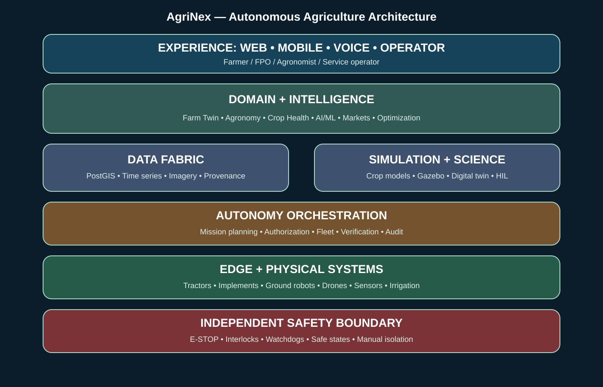

# Architecture and Software Design

Layers: experience (web/mobile/voice/operator); domain (farm/crop/agronomy/soil/irrigation/protection/harvest/market); intelligence (science/ML/decision/optimization); data fabric (GIS/time series/imagery/provenance); autonomy (mission/scheduler/authorization/fleet/verification); edge/device (gateway/sensors/PLC/ROS 2/drones/adapters); independent safety (E-stop/controller/interlocks/watchdogs/isolation).

Feedback: observe → validate → estimate state → recommend → risk-check/simulate → authorize → dispatch → execute locally → verify → audit → learn.

Technology: React/TypeScript; Python/FastAPI; PostgreSQL/PostGIS; TimescaleDB; MinIO/S3; GDAL/Rasterio/QGIS; PyTorch/OpenCV/ONNX; ROS 2/Nav2/Gazebo; MQTT; OR-Tools; MLflow; OpenTelemetry/Prometheus/Grafana; embedded C/C++/Rust.

Rules: modular monolith first; versioned APIs/events; explicit units/CRS/time; authenticated, bounded, time-limited and audited commands; distinguish desired state/command/acknowledgement/measured state/verified outcome; local control during outage; agents cannot bypass safety; replaceable adapters; transparent farm data rights.
